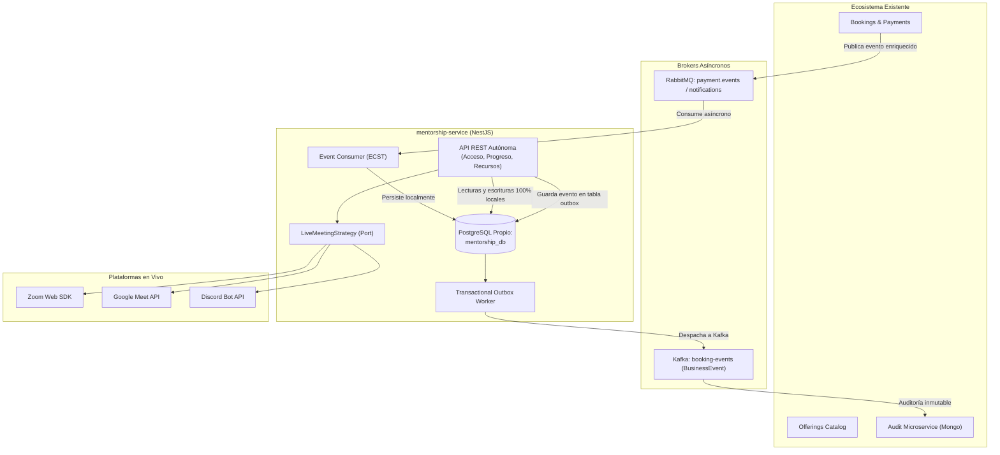

# Historias de Usuario y Arquitectura de Migración a NestJS: Microservicio de Mentorías

## 1. Estrategia de Arquitectura: ¿Es conveniente manejar un Monorepo?

**Sí, manejar un Monorepo es la mejor decisión para SkillBridge.** De hecho, el repositorio ya opera bajo este modelo arquitectónico al alojar:
* `backend/` (Monolito modular en Spring Boot 3.5.6)
* `frontend/` (SPA en Angular 20)
* `audit-service/` (Microservicio independiente desacoplado: backend Spring Boot + MongoDB + frontend Angular)

### Ventajas de integrar `mentorship-service/` dentro del Monorepo:
1. **Desarrollo local orquestado:** Un único archivo `docker-compose.yml` levanta toda la infraestructura distribuida (PostgreSQL, MongoDB, Redis, RabbitMQ 4, Apache Kafka 7.8, Mailpit) y permite arrancar todos los servicios con una sola instrucción.
2. **Versionado atómico de contratos (OpenAPI / Eventos):** Cuando el microservicio de mentorías emite un nuevo evento o expone una ruta REST, el frontend Angular puede actualizarse y verificarse en el **mismo Pull Request**, eliminando incompatibilidades entre versiones de repositorios separados.
3. **CI/CD unificado con despliegues independientes:** Las GitHub Actions (`.github/workflows/ci.yml`) pueden usar filtros por directorio (`paths: ['mentorship-service/**']`) para construir, probar y desplegar `mentorship-service/` en su propio contenedor (Docker/Kubernetes/Render/Railway) sin necesidad de re-desplegar los demás servicios.
4. **Independencia lógica sin dispersión operativa:** Cada microservicio mantiene su propio `package.json`, su propio Dockerfile y sus propias migraciones, conservando autonomía tecnológica sin la complejidad de coordinar múltiples repositorios en GitHub.

---

## 2. Pilares de Aislamiento e Independencia entre Servicios

Para garantizar que el microservicio en NestJS sea verdaderamente **autónomo y desacoplado** (sin que una caída de `Bookings`, `Users` o `Offerings` degrade el aula virtual):



1. **Database-per-Service:** `mentorship-service` tiene su propia base de datos (`mentorship_db` en PostgreSQL). No comparte tablas ni contiene claves foráneas (`FOREIGN KEY`) hacia `users`, `bookings` o `offerings`.
2. **Event-Carried State Transfer (ECST):** El evento de pago aprobado transporta todos los atributos necesarios (`bookingId`, `customerId`, `customerEmail`, `offeringId`, `offeringTitle`, `providerId`, `scheduledAt`, `mode`, etc.). El microservicio **no necesita hacer llamadas HTTP síncronas** para consultar datos al momento de aprovisionar.
3. **Autonomía Operativa de Ejecución:** Una vez aprovisionada, todas las operaciones de consulta, autorización de aula, descarga de recursos y avance de progreso se resuelven **exclusivamente contra la base de datos local**.
4. **Transactional Outbox Pattern:** Los eventos de dominio hacia Kafka se guardan en una tabla local `outbox_events` en la misma transacción ACID de la mentoría. Un worker en background los publica en Kafka con reintentos exponenciales, evitando pérdida de eventos o bloqueos si Kafka tiene latencia.
5. **Autenticación sin Estado (Stateless JWT):** Valida la firma del token mediante la clave pública compartida (`JWT_PUBLIC_KEY`). Extrae `userId`, `email` y `role` de los claims sin consultar la base de datos de usuarios.

---

## 3. Matriz de Proveedores de Mentorías en Vivo (Multi-Provider Strategy)

El microservicio desacopla las sesiones sincrónicas mediante el patrón Strategy (`LiveMeetingPort`):

| Proveedor | Mecanismo de Integración | Control de Acceso y Sala |
|---|---|---|
| **Zoom** | Server-to-Server OAuth API | Genera `meetingId`, `passcode` y firma HMAC-SHA256 (`zoomSignature`) de corta duración para el Zoom Embedded Web SDK. |
| **Google Meet** | Google Calendar / Workspace API | Genera espacio de reunión seguro (`meet.google.com/xxx-yyyy-zzz`), asignando al mentor como co-organizador y permitiendo ingreso restringido al email del alumno. |
| **Discord** | Discord Bot API / Guild API | Crea dinámicamente un canal de voz/video temporal o genera una invitación de un solo uso con expiración configurada para la ventana de la sesión. |
| **Custom URL** | Enlace externo seguro | Permite al mentor registrar una sala externa o enlace corporativo previamente acordado. |

---

## 4. Backlog de Historias de Usuario (Agile / INVEST)

### HU-MNT-01: Configuración base del microservicio y modelo relacional aislado
* **Como** desarrollador backend de NestJS,
* **quiero** inicializar el proyecto `mentorship-service` con validación de configuración estricta y base de datos PostgreSQL propia con Prisma,
* **para** garantizar aislamiento físico y persistencia relacional sin dependencias directas de esquemas ajenos.

#### Criterios de Aceptación (Gherkin):
```gherkin
Escenario: Validación estricta de variables de entorno al arrancar
  Dado que el servicio inicia
  Cuando falte alguna variable obligatoria (DATABASE_URL, JWT_PUBLIC_KEY, RABBITMQ_URL, KAFKA_BROKERS)
  Entonces el proceso debe abortar el arranque de inmediato arrojando un error descriptivo con Joi/class-validator.

Escenario: Creación de esquema y restricciones relacionales
  Dado el esquema de Prisma en mentorship_db
  Cuando se ejecutan las migraciones
  Entonces se crean las tablas mentorship_assignments, mentorship_resources y outbox_events
  Y mentorship_assignments tiene una restricción única sobre booking_id
  Y los campos customer_id, offering_id y booking_id se indexan sin claves foráneas a tablas externas.
```

---

### HU-MNT-02: Aprovisionamiento asíncrono e idempotente por Event-Carried State Transfer
* **Como** sistema SkillBridge,
* **quiero** consumir el evento `PaymentApproved` desde RabbitMQ y aprovisionar la mentoría usando la información contenida en el mensaje,
* **para** dar acceso inmediato al estudiante sin realizar peticiones síncronas a otros microservicios.

#### Criterios de Aceptación (Gherkin):
```gherkin
Escenario: Aprovisionamiento exitoso sin dependencias HTTP
  Dado un mensaje en la cola mentorship.payment.approved.queue con el payload enriquecido
  Cuando el consumidor procesa el evento
  Entonces crea la asignación en estado SCHEDULED, modo ASYNCHRONOUS o LIVE según corresponda, progreso 0%
  Y establece la ventana de acceso [scheduledAt, scheduledAt + durationHours]
  Y confirma el mensaje (ACK) a RabbitMQ.

Escenario: Idempotencia ante mensajes duplicados o reintentos
  Dado un evento recibido cuyo booking_id ya existe en mentorship_assignments
  Cuando el consumidor intente procesarlo
  Entonces detecta el registro existente, confirma el mensaje con ACK y no genera registros duplicados ni errores 500.

Escenario: Fallo no recuperable a Dead Letter Queue
  Dado un mensaje corrupto o con datos estructuralmente inválidos
  Cuando falla tras 3 reintentos exponenciales
  Entonces el mensaje se enruta a mentorship.payment.dlq para inspección y auditoría.
```

---

### HU-MNT-03: Consulta y gestión del ciclo de vida y progreso (Regla 1 Pago = 1 Mentoría)
* **Como** estudiante autenticado,
* **quiero** consultar mis mentorías contratadas y reportar mi porcentaje de avance,
* **para** registrar mi aprendizaje y culminar el servicio contratado.

#### Criterios de Aceptación (Gherkin):
```gherkin
Escenario: Consulta de mentorías propias
  Dado un usuario con rol CUSTOMER autenticado mediante JWT
  Cuando realiza GET /api/v1/mentorships/me
  Entonces responde código 200 con la lista de sus asignaciones ordenadas por accessStartsAt descendente.

Escenario: Actualización de progreso intermedio
  Dado un estudiante con mentoría activa dentro de su ventana de horario
  Cuando envía PATCH /api/v1/mentorships/:id/progress con { "progressPercent": 60 }
  Entonces el estado pasa a IN_PROGRESS y actualiza el porcentaje.

Escenario: Finalización irreversible de la mentoría (pago consumido)
  Dado un estudiante dentro de su ventana de acceso
  Cuando envía PATCH /api/v1/mentorships/:id/progress con { "progressPercent": 100 }
  Entonces el estado pasa a COMPLETED, se registra completedAt = now()
  Y cualquier intento posterior de reiniciar el progreso es rechazado con 400 Bad Request.
```

---

### HU-MNT-04: Control de acceso estricto en servidor para aula virtual
* **Como** estudiante autenticado,
* **quiero** solicitar la autorización de acceso a mi sesión de mentoría,
* **para** ingresar al aula o sala únicamente cuando mi pago, fecha y estado sean válidos.

#### Criterios de Aceptación (Gherkin):
```gherkin
Escenario: Acceso permitido dentro de la ventana horaria
  Dado un estudiante con asignación propia activa
  Cuando hace GET /api/v1/mentorships/:id/access y se cumple accessStartsAt <= now < accessEndsAt
  Entonces responde 200 OK con assignmentId, mode, accessEndsAt y datos de conexión de la sala.

Escenario: Acceso rechazado por ventana aún no iniciada
  Dado un estudiante con asignación válida
  Cuando intenta acceder antes de accessStartsAt
  Entonces responde 403 Forbidden indicando "La mentoría aún no está disponible".

Escenario: Acceso bloqueado por mentoría vencida o completada
  Dado un estudiante intentando acceder cuando now >= accessEndsAt o estado es COMPLETED o CANCELLED
  Entonces responde 403 Forbidden indicando "El acceso a esta mentoría ya no está habilitado".
```

---

### HU-MNT-05: Administración de recursos didácticos por enlace (URL)
* **Como** Provider propietario del servicio (o Admin),
* **quiero** crear, editar, listar y eliminar enlaces de estudio asociados a un offering,
* **para** suministrar material complementario a los estudiantes.

#### Criterios de Aceptación (Gherkin):
```gherkin
Escenario: Validación de pertenencia al crear recurso
  Dado un usuario autenticado con rol PROVIDER
  Cuando envía POST /api/v1/mentorship-resources/offerings/:offeringId
  Entonces valida que el providerId del offering coincida con su identidad (o sea ADMIN)
  Y verifica que title no supere 160 caracteres y url inicie con http:// o https://.

Escenario: Visualización de recursos para alumno autorizado
  Dado un estudiante con mentoría vigente para dicho offering
  Cuando realiza GET /api/v1/mentorships/:id/resources
  Entonces recibe los recursos ordenados por fecha de publicación.
```

---

### HU-MNT-06: Carga y descarga protegida de archivos (Storage Port)
* **Como** Provider y estudiante autorizado,
* **quiero** subir guías de estudio (hasta 10 MB) y descargarlas de forma segura,
* **para** compartir material descargable sin exponer enlaces públicos directos.

#### Criterios de Aceptación (Gherkin):
```gherkin
Escenario: Subida de archivo por Provider
  Dado un Provider dueño del offering
  Cuando sube un archivo vía POST /api/v1/mentorship-resources/offerings/:offeringId/file (multipart/form-data)
  Entonces el backend valida tamaño <= 10 MB, sanitiza el nombre y delega al StorageAdapter (S3/Local)
  Y almacena el recurso con resourceType = DOCUMENT.

Escenario: Descarga autorizada para alumno
  Dado un estudiante con asignación activa dentro de su ventana temporal
  Cuando realiza GET /api/v1/mentorship-resources/:id/file
  Entonces el servidor retorna el stream del archivo con headers:
    - Content-Disposition: attachment; filename="..."
    - X-Content-Type-Options: nosniff
    - Cache-Control: no-store.

Escenario: Descarga bloqueada para usuarios sin acceso
  Dado un usuario anónimo o un estudiante fuera de su ventana de mentoría
  Cuando intenta descargar el archivo por su URL directa
  Entonces responde 403 Forbidden.
```

---

### HU-MNT-07: Mentorías en vivo multi-proveedor (Zoom, Google Meet, Discord)
* **Como** Provider de una mentoría sincrónica,
* **quiero** generar la sala de reunión seleccionando entre Zoom, Google Meet o Discord,
* **para** impartir la sesión en la plataforma elegida de manera segura.

#### Criterios de Aceptación (Gherkin):
```gherkin
Escenario: Creación de sala Zoom
  Dado una mentoría LIVE
  Cuando el Provider solicita creación con liveProvider = ZOOM
  Entonces interactúa con la API de Zoom OAuth, crea la reunión y almacena meetingId, passcode y joinUrl.

Escenario: Creación de sala Google Meet
  Dado una mentoría LIVE
  Cuando el Provider solicita creación con liveProvider = GOOGLE_MEET
  Entonces interactúa con Google Calendar/Workspace API y genera el enlace seguro meet.google.com/xxx-yyyy-zzz.

Escenario: Creación de canal/invitación Discord
  Dado una mentoría LIVE
  Cuando el Provider solicita creación con liveProvider = DISCORD
  Entonces interactúa con la API del Bot de Discord y genera un canal de voz temporal o invitación de un solo uso.

Escenario: Idempotencia en creación de sesiones en vivo
  Dado que una mentoría ya tiene una sala configurada
  Cuando se vuelve a invocar la creación
  Entonces retorna la sesión existente sin duplicar reuniones en los proveedores externos.
```

---

### HU-MNT-08: Publicación confiable de auditoría a Apache Kafka (Transactional Outbox)
* **Como** oficial de auditoría de la plataforma,
* **quiero** que todos los eventos de dominio de mentorías se publiquen en el topic `booking-events` de Kafka bajo el envelope `BusinessEvent<T>`,
* **para** que el microservicio de auditoría (`audit-service`) persista el historial sin acoplamiento temporal.

#### Criterios de Aceptación (Gherkin):
```gherkin
Escenario: Persistencia atómica en tabla outbox
  Dado un evento relevante (MentorshipProvisioned, MentorshipCompleted, MentorshipCancelled)
  Cuando se procesa la transacción de la mentoría
  Entonces el registro en outbox_events se guarda dentro de la misma transacción ACID de PostgreSQL.

Escenario: Publicación asíncrona hacia Kafka
  Dado el worker en segundo plano de NestJS
  Cuando detecta registros PENDING en outbox_events
  Entonces publica en Kafka en el topic booking-events con el envelope BusinessEvent<T>
  Y marca el registro como PUBLISHED.

Escenario: Tolerancia a caídas de Kafka
  Dado que el cluster de Kafka no responde
  Cuando el worker intenta publicar
  Entonces el worker reintenta con retroceso exponencial sin arrojar errores al usuario final.
```

---

### HU-MNT-09: Resiliencia ante fallos de proveedores en vivo (Circuit Breaker y Fallback)
* **Como** Provider o estudiante,
* **quiero** disponer de alternativas si la API de Zoom, Meet o Discord falla o tarda en responder,
* **para** que la sesión de mentoría no quede bloqueada.

#### Criterios de Aceptación (Gherkin):
```gherkin
Escenario: Fallback ante timeout de Zoom/Meet/Discord
  Dado que una API externa tarda más de 4 segundos o responde con error 5xx
  Cuando el Circuit Breaker interrumpe la llamada
  Entonces el sistema notifica el fallo al mentor y le permite ingresar una URL alternativa o cambiar de proveedor.

Escenario: Autonomía de lectura de acceso
  Dado un estudiante que consulta GET /api/v1/mentorships/:id/access
  Cuando la sala ya fue creada previamente
  Entonces los datos de conexión se entregan directamente desde PostgreSQL local sin consultar a las APIs externas.
```

---

## 5. Estructura de Directorios Recomendada en el Monorepo

```text
SkillBridge-AI-JAVA-Angular/
├── backend/                       # Monolito modular Spring Boot
├── frontend/                      # SPA Angular 20
├── audit-service/                 # Microservicio de auditoría (Spring Boot + Mongo)
├── mentorship-service/            # NUEVO MICROSERVICIO (Node.js + NestJS)
│   ├── Dockerfile
│   ├── package.json
│   ├── tsconfig.json
│   ├── prisma/
│   │   ├── schema.prisma
│   │   └── migrations/
│   └── src/
│       ├── main.ts
│       ├── app.module.ts
│       ├── config/                # @nestjs/config + Joi
│       ├── auth/                  # JWT Guards y Roles Decorators
│       ├── mentorships/           # Módulo de Asignaciones y Control de Acceso
│       │   ├── mentorships.controller.ts
│       │   ├── mentorships.service.ts
│       │   └── dto/
│       ├── resources/             # Módulo de Recursos y Archivos
│       │   ├── resources.controller.ts
│       │   ├── resources.service.ts
│       │   └── storage/           # S3StorageAdapter y LocalStorageAdapter
│       ├── live-meetings/         # Multi-Provider Strategy
│       │   ├── live-meeting.port.ts
│       │   ├── zoom.adapter.ts
│       │   ├── google-meet.adapter.ts
│       │   └── discord.adapter.ts
│       ├── messaging/             # Integración con Brokers
│       │   ├── rabbitmq/          # PaymentApproved Consumer
│       │   └── kafka/             # BusinessEvent Producer & Outbox Worker
│       └── database/              # PrismaService
├── docker-compose.yml             # Orquesta todos los servicios del Monorepo
└── docs/
    ├── MENTORIAS-MICROSERVICIO.md
    └── HISTORIAS-USUARIO-NESTJS.md
```

---

## 6. Definition of Done (DoD) para cada Historia

- [ ] Código desarrollado en TypeScript estricto bajo NestJS 10+.
- [ ] Pruebas unitarias de servicios y adapters con Jest (> 85% cobertura).
- [ ] Pruebas de integración E2E con Supertest y base de datos PostgreSQL de test (Testcontainers o Docker local).
- [ ] Validación de DTOs con `class-validator` y `class-transformer`.
- [ ] Endpoints documentados con Swagger / OpenAPI (`@nestjs/swagger`).
- [ ] Registro de logs estructurados con correlación (`correlationId`).
- [ ] Cero dependencias síncronas hacia las bases de datos de otros microservicios.
- [ ] Verificación en CI/CD con linter y compilación en verde.
