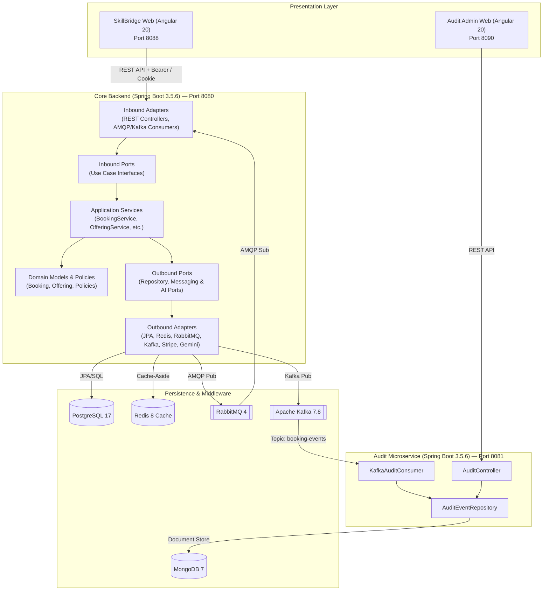
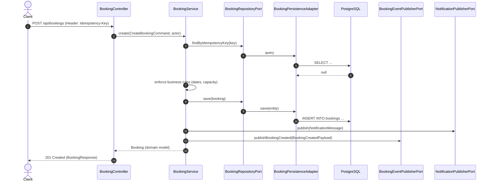

# Architecture Overview — SkillBridge AI

This document establishes the verified architectural foundation of the SkillBridge AI platform, detailing subsystem boundaries, dependency directions, event-driven topologies, and persistence mechanisms.

---

## 1. High-Level Architectural Paradigm

The system implements a **hybrid architecture**:
1. **Core Backend (`backend/`)**: Structured as a **Modular Monolith** applying **Hexagonal Architecture (Ports and Adapters)**.
2. **Audit Subsystem (`audit-service/`)**: Structured as an **Independent Event-Driven Microservice** consuming from Apache Kafka and persisting to MongoDB.
3. **Frontend Applications (`frontend/` & `audit-service/frontend/`)**: Single-Page Applications (SPAs) built with Angular 20 and Tailwind CSS.



---

## 2. Hexagonal Architecture in Core Backend (`backend/`)

The core backend strictly enforces the dependency inversion rule. Outer infrastructure details depend on inner application abstractions; the domain depends on nothing.

```text
[ Infrastructure Layer ]
   ├── adapter/in/rest/            <- Controllers (OfferingController, BookingController, etc.)
   ├── adapter/in/messaging/       <- Inbound consumers (KafkaAuditConsumer, NotificationConsumer)
   ├── adapter/out/persistence/    <- JPA Adapters (BookingPersistenceAdapter, UserPersistenceAdapter)
   ├── adapter/out/cache/          <- RedisOfferingCacheAdapter
   ├── adapter/out/messaging/      <- KafkaBookingEventPublisher, RabbitNotificationPublisher
   ├── adapter/out/ai/             <- GeminiAiAdapter, OpenAiAiAdapter, ElevenLabsTextToSpeechAdapter
   ├── adapter/out/payment/        <- StripePaymentAdapter, SimulatedPaymentAdapter
   ├── security/                   <- JwtAuthenticationFilter, RestAccessDeniedHandler, JwtService
   └── config/                     <- SecurityConfiguration, RabbitConfiguration, DomainConfig
           │
           │ implements / invokes
           ▼
[ Application Layer ]
   ├── port/in/                    <- Inbound Use Case interfaces (CreateBookingUseCase, etc.)
   ├── port/out/                   <- Outbound Port interfaces (BookingRepositoryPort, AiRecommendationPort)
   ├── port/out/event/             <- AuditEventPublisherPort, BusinessEvent envelope
   └── service/                    <- Application orchestration (BookingService, AiRecommendationService)
           │
           │ enforces rules / manipulates
           ▼
[ Domain Layer ] (Pure Java)
   ├── model/                      <- Booking, Offering, Category, UserAccount, Actor, BookingStatus
   ├── policy/                     <- OfferingAccessPolicy, UserManagementPolicy
   ├── service/                    <- BookingCancellationPolicy
   ├── event/                      <- PaymentApproved, PaymentRejected
   └── exception/                  <- BusinessRuleException, DomainNotFoundException, etc.
```

### Verified Dependency Invariants:
- `com.riwi.skillbridge.domain.*`: Has zero imports of `org.springframework.*`, `jakarta.persistence.*`, or external libraries. Pure domain logic.
- `com.riwi.skillbridge.application.port.*`: Interfaces defining input and output boundaries. Uses domain models and Java standard types.
- `com.riwi.skillbridge.infrastructure.*`: Contains all framework annotations (`@RestController`, `@Service`, `@Repository`, `@Configuration`).

---

## 3. Communication & Event Flows

### 3.1. Synchronous Request Flow (Booking Example)


### 3.2. Asynchronous Notification Flow (RabbitMQ)
1. **Producer**: [RabbitNotificationPublisher.java](file:///home/santiagojava/IdeaProjects/rejuv-wt/SkillBridge-AI-JAVA-Angular/backend/src/main/java/com/riwi/skillbridge/infrastructure/adapter/out/messaging/RabbitNotificationPublisher.java) sends messages to exchange `skillbridge.notifications` with routing key `notification.booking`.
2. **Broker Configuration**: [RabbitConfiguration.java](file:///home/santiagojava/IdeaProjects/rejuv-wt/SkillBridge-AI-JAVA-Angular/backend/src/main/java/com/riwi/skillbridge/infrastructure/config/RabbitConfiguration.java) sets up:
   - Primary Queue: `skillbridge.notifications.queue` with DLX `skillbridge.notifications.dlx`.
   - Retry policy: 3 attempts with exponential backoff (initial 2s, multiplier 2.0, max 10s).
   - Dead Letter Queue: `skillbridge.notifications.dlq`.
3. **Consumer**: [NotificationConsumer.java](file:///home/santiagojava/IdeaProjects/rejuv-wt/SkillBridge-AI-JAVA-Angular/backend/src/main/java/com/riwi/skillbridge/infrastructure/adapter/in/messaging/NotificationConsumer.java) delegates processing to `NotificationService`, dispatching either simulated logs or transactional emails via [EmailNotificationSender.java](file:///home/santiagojava/IdeaProjects/rejuv-wt/SkillBridge-AI-JAVA-Angular/backend/src/main/java/com/riwi/skillbridge/infrastructure/adapter/out/notification/EmailNotificationSender.java) to Mailpit.

### 3.3. Persistent Audit Event Streaming (Kafka)
1. **Envelope Structure**: All Kafka messages encapsulate payloads in `BusinessEvent<T>` containing:
   - `eventId` (UUID), `eventType` (String), `aggregateId` (String), `aggregateType` (String), `occurredAt` (Instant), `correlationId` (String), `version` (int), `payload` (T).
2. **Topic Unification Trade-off**:
   - `application.yml` configures:
     - `app.kafka.topic.booking-events: booking-events`
     - `app.kafka.topic.audit-events: booking-events`
   - *Rationale*: [audit-service/backend/src/main/java/com/riwi/audit/consumer/KafkaAuditConsumer.java](file:///home/santiagojava/IdeaProjects/rejuv-wt/SkillBridge-AI-JAVA-Angular/audit-service/backend/src/main/java/com/riwi/audit/consumer/KafkaAuditConsumer.java) is compiled to listen strictly to `${app.kafka.topic.booking-events}`. Both business events (`BookingCreated`, `BookingCancelled`) and audit events (`UserLoggedIn`, `UserRegistered`, `OfferingCreated`) publish to this topic to ensure full capture.

---

## 4. Persistence Strategies

| Datastore | Scope | Mechanism | Schema & Migrations |
|---|---|---|---|
| **PostgreSQL 17** | Core Backend | Spring Data JPA / Hibernate (`ddl-auto: validate`) | Flyway migrations `V1__init.sql` through `V7__booking_idempotency.sql` in `backend/src/main/resources/db/migration/`. |
| **Redis 8** | Core Backend | Spring Data Redis (`StringRedisTemplate` / Jackson serialization) | Cache-Aside pattern. Key `catalog::offerings` cached with 10-minute TTL. Evicted upon offering mutations. |
| **MongoDB 7** | Audit Subsystem | Spring Data MongoDB (`MongoTemplate` / `AuditEventRepository`) | Programmatic migrations via [AuditMongoInitializer.java](file:///home/santiagojava/IdeaProjects/rejuv-wt/SkillBridge-AI-JAVA-Angular/audit-service/backend/src/main/java/com/riwi/audit/config/AuditMongoInitializer.java) (`ApplicationRunner` creating collections and ascending/descending indexes). |

---

## 5. Architectural Constraints & Invariants

1. **Correlation ID Traceability**:
   - Inbound HTTP filter [CorrelationIdFilter.java](file:///home/santiagojava/IdeaProjects/rejuv-wt/SkillBridge-AI-JAVA-Angular/backend/src/main/java/com/riwi/skillbridge/infrastructure/adapter/in/rest/filter/CorrelationIdFilter.java) captures or generates `X-Correlation-Id`, binding it to SLF4J MDC.
   - The correlation ID is propagated into RabbitMQ and Kafka message headers and domain event envelopes.
2. **Idempotent State Changes**:
   - Mutating commands (`POST /api/bookings`, `POST /api/payments/authorize`) mandate the `Idempotency-Key` HTTP header.
   - Database unique index `idx_bookings_idempotency_key` guarantees exactly-once processing even under network retries.
3. **Decoupled Audit Microservice**:
   - `audit-service/` has no shared Maven or npm code with `backend/` or `frontend/`. All communication is strictly asynchronous through Kafka or decoupled HTTP REST queries.
