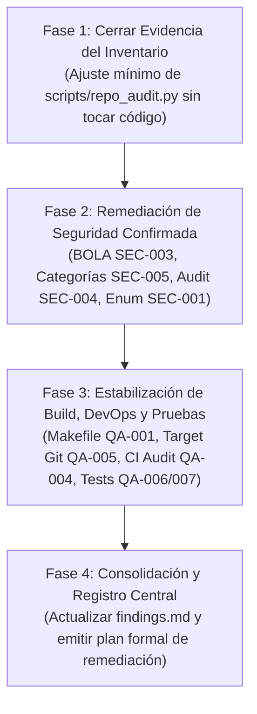

# Informe de Revisión Cruzada Independiente de Auditoría — SkillBridge AI

**Destino del informe:** `docs/audit/evidence/04-cross-review.md`  
**Rol del auditor:** Auditor Coordinador Técnico y de Calidad  
**Fecha UTC de emisión:** 2026-10-21T19:35:00Z  
**Alcance exclusivo:** Revisión cruzada e independiente de los informes y evidencias generados por los tres agentes especializados (Inventario, Seguridad, y Build/CI/DevOps), verificación estática en el código fuente de producto y configuración, y consolidación técnica sin modificaciones de código ni ejecuciones destructivas.

---

## 1. Integridad de las Fuentes y Contexto de Ejecución (Tarea A)

### 1.1. Metadatos de Git y Entorno Operativo

Se ejecutaron consultas de solo lectura en la raíz del espacio de trabajo `/home/santiagojava/IdeaProjects/rejuv-wt/SkillBridge-AI-JAVA-Angular`:

```bash
date -u +"%Y-%m-%dT%H:%M:%SZ"
git rev-parse --abbrev-ref HEAD
git rev-parse HEAD
git status --short
sha256sum scripts/repo_audit.py
```

| Variable | Valor verificado en el entorno |
|---|---|
| **Fecha UTC de auditoría** | `2026-10-21T19:35:00Z` |
| **Rama Git activa** | `develop` |
| **Commit HEAD auditado** | `cdd009aa8c9ba351fa8bb50bb1ad0a381e259793` |
| **Mensaje de commit HEAD** | `Merge pull request #73 from Danilo-Doria/Bugfix/BUG-04-Categoria` |
| **SHA-256 de `scripts/repo_audit.py`** | `502a369be6bb5a3e67e252903182349c6484dd6b1c371e9018fa179695f59a50` |

### 1.2. Estado del Árbol de Trabajo (`git status --short`)

```text
AM docs/audit/findings.md
A  scripts/repo_audit.py
?? docs/audit/evidence/
?? docs/audit/generated/
```

- **Análisis de estado:**
  - `scripts/repo_audit.py`: Staged (`A`), idéntico al SHA-256 registrado en el baseline.
  - `docs/audit/findings.md`: Presenta un estado mixto `AM` (cambios staged y cambios unstaged).
    - **Cambio staged:** Creación inicial del archivo con tabla preliminar de hallazgos AUD-INV-001 a AUD-INV-006.
    - **Cambio unstaged:** Ajuste en la ruta de referencia a `evidence/01-inventory-gap.md`.
    - **Preservación:** Conforme a la regla 5, este archivo se mantiene estrictamente intacto durante esta fase coordinadora.
  - `docs/audit/evidence/` y `docs/audit/generated/`: Directorios sin rastrear (`??`), contenedores de la evidencia generada por las fases de auditoría.

### 1.3. Inventario y Verificación de Documentos Fuentes

Se comprobó la existencia y coherencia de las rutas documentales:

| Documento Fuente | Ruta Real en Sistema de Archivos | Estado | Observaciones de Integridad |
|---|---|---|---|
| **Baseline inicial** | [docs/audit/evidence/00-baseline.txt](file:///home/santiagojava/IdeaProjects/rejuv-wt/SkillBridge-AI-JAVA-Angular/docs/audit/evidence/00-baseline.txt) | **DISPONIBLE** | Registra fecha inicial `2026-10-21T18:48:09+00:00`, commit `cdd009a...`, SHA-256 del script idéntico. La primera línea contiene una secuencia de escape de terminal capturada en la redirección. |
| **Validación de Inventario (Detallado)** | [docs/audit/evidence/01-inventory-validation.md](file:///home/santiagojava/IdeaProjects/rejuv-wt/SkillBridge-AI-JAVA-Angular/docs/audit/evidence/01-inventory-validation.md) | **DISPONIBLE** | Informe exhaustivo del especialista en inventario (472 líneas), con conciliación formal de 92 omisiones. |
| **Brecha de Inventario (Preliminar)** | [docs/audit/evidence/01-inventory-gap.md](file:///home/santiagojava/IdeaProjects/rejuv-wt/SkillBridge-AI-JAVA-Angular/docs/audit/evidence/01-inventory-gap.md) | **DISPONIBLE** | Documento complementario previo enfocado en el mecanismo de exclusión y stack omitido. |
| **Brecha Local de Inventario** | [docs/audit/evidence/01-inventory-gap-local-20261021-135817.md](file:///home/santiagojava/IdeaProjects/rejuv-wt/SkillBridge-AI-JAVA-Angular/docs/audit/evidence/01-inventory-gap-local-20261021-135817.md) | **DISPONIBLE** | Dump de evidencia de 78 archivos de `adapter/out` y `port/out`. |
| **Revisión de Seguridad** | [docs/audit/evidence/02-security-review.md](file:///home/santiagojava/IdeaProjects/rejuv-wt/SkillBridge-AI-JAVA-Angular/docs/audit/evidence/02-security-review.md) | **DISPONIBLE** | Informe de seguridad de 755 líneas, con desglose de hallazgos SEC-001 a SEC-010. |
| **Revisión de Build y DevOps** | [docs/audit/evidence/03-build-review.md](file:///home/santiagojava/IdeaProjects/rejuv-wt/SkillBridge-AI-JAVA-Angular/docs/audit/evidence/03-build-review.md) | **DISPONIBLE** | Informe de calidad de compilación y CI de 456 líneas, con hallazgos QA-001 a QA-012. |
| **Índices Generados** | [docs/audit/generated/](file:///home/santiagojava/IdeaProjects/rejuv-wt/SkillBridge-AI-JAVA-Angular/docs/audit/generated/) | **DISPONIBLES** | 6 archivos: `files.csv`, `00-summary.md`, `01-java-index.md`, `02-angular-index.md`, `03-config-tests.md`, `04-todos.md`. |
| **Registro de Hallazgos** | [docs/audit/findings.md](file:///home/santiagojava/IdeaProjects/rejuv-wt/SkillBridge-AI-JAVA-Angular/docs/audit/findings.md) | **DISPONIBLE** | Archivo en estado staged/unstaged; solo contiene hallazgos de inventario preliminares. |

---

## 2. Revisión Cruzada del Inventario de Repositorio (Tarea B)

### 2.1. Causa Raíz de la Exclusión de Carpetas `out`

Se inspeccionó [scripts/repo_audit.py](file:///home/santiagojava/IdeaProjects/rejuv-wt/SkillBridge-AI-JAVA-Angular/scripts/repo_audit.py):
- En las líneas 20-25, la constante `EXCLUDED_DIRS` contiene la cadena literal `"out"`.
- En las líneas 115-127, dentro de la función `walk_files`:
  ```python
  115: for d in dirs:
  116:     if d in EXCLUDED_DIRS:
  117:         continue
  ...
  127: dirs[:] = filtered
  ```
- **Mecanismo:** La comparación evalúa únicamente el nombre de carpeta simple (`d`), no su ruta relativa al root ni su condición de carpeta de compilación en la raíz (ej. `./out` de IntelliJ IDEA).
- En una arquitectura hexagonal con paquetes `application/port/out` e `infrastructure/adapter/out`, cualquier descenso de `os.walk` hacia un subdirectorio llamado `out` es podado de manera inmediata e incondicional.

### 2.2. Conciliación Matemática Estricta: Git vs. `files.csv`

Se contrastaron las rutas rastreadas por Git contra los registros de [docs/audit/generated/files.csv](file:///home/santiagojava/IdeaProjects/rejuv-wt/SkillBridge-AI-JAVA-Angular/docs/audit/generated/files.csv):

$$\text{Rutas rastreadas por Git} = 385$$
$$\text{Líneas de datos en files.csv} = 293 \quad (\text{294 líneas en total con encabezado})$$
$$\text{Diferencia bruta neta} = 385 - 293 = 92 \text{ archivos}$$

La diferencia se descompone exactamente en 5 conjuntos disjuntos sin residuos:

```text
┌────────────────────────────────────────────────────────┬───────────┬─────────────────────────────────────────────────────────┐
│ Causa Técnica de la Discrepancia                       │ Cantidad  │ Justificación / Línea en repo_audit.py                  │
├────────────────────────────────────────────────────────┼───────────┼─────────────────────────────────────────────────────────┤
│ 1. Arquitectura Hexagonal (adapter/out y port/out)     │ 78        │ repo_audit.py:22 y 116 ("out" en EXCLUDED_DIRS).        │
│ 2. Excepción de dominio (InvalidCredentialsException)  │ 1         │ repo_audit.py:76 ("credential" en is_sensitive).        │
│ 3. Plantillas de entorno (.env.example y audit .env)   │ 2         │ repo_audit.py:72 (startswith(".env") en is_sensitive).  │
│ 4. Binarios compilados en audit-service/backend/target │ 10        │ repo_audit.py:21 ("target" en EXCLUDED_DIRS).           │
│ 5. Archivo docs/audit/findings.md en staging           │ 1         │ Creado después de la corrida inicial de repo_audit.py.  │
├────────────────────────────────────────────────────────┼───────────┼─────────────────────────────────────────────────────────┤
│ Total conciliado exacto                                │ 92        │ Residuo no explicado: 0 archivos.                       │
└────────────────────────────────────────────────────────┴───────────┴─────────────────────────────────────────────────────────┘
```

### 2.3. Rectificación del Conteo de Archivos Java (AUD-INV-006)

- En [docs/audit/findings.md](file:///home/santiagojava/IdeaProjects/rejuv-wt/SkillBridge-AI-JAVA-Angular/docs/audit/findings.md), la hipótesis preliminar indicaba que existían 228 archivos `.java` en Git.
- **Verificación real:** El comando `git ls-files -- '*.java' | wc -l` arroja exactamente **229** archivos `.java`.
- En `files.csv` se registraron **150** archivos `.java`.
- La brecha real de código Java omitido es de $229 - 150 = 79$ archivos:
  - **78** archivos `.java` bajo `adapter/out` y `port/out`.
  - **1** archivo `.java` de dominio: [InvalidCredentialsException.java](file:///home/santiagojava/IdeaProjects/rejuv-wt/SkillBridge-AI-JAVA-Angular/backend/src/main/java/com/riwi/skillbridge/domain/exception/InvalidCredentialsException.java).

### 2.4. El Caso `JpaUserRepository`: Discrepancia del Inventario vs. Defecto Arquitectónico

Se auditó por qué [JpaUserRepository](file:///home/santiagojava/IdeaProjects/rejuv-wt/SkillBridge-AI-JAVA-Angular/backend/src/main/java/com/riwi/skillbridge/infrastructure/adapter/out/persistence/repository/JpaUserRepository.java) figuraba en [01-java-index.md](file:///home/santiagojava/IdeaProjects/rejuv-wt/SkillBridge-AI-JAVA-Angular/docs/audit/generated/01-java-index.md) a pesar de estar ausente de `files.csv`:

1. **Hallazgo en el inventario:**
   - La cadena `JpaUserRepository` aparece exclusivamente en la línea 214 de `01-java-index.md`, dentro de una tabla de *"Security markers"*.
   - El archivo analizado en esa línea fue [DatabaseUserDetailsService.java](file:///home/santiagojava/IdeaProjects/rejuv-wt/SkillBridge-AI-JAVA-Angular/backend/src/main/java/com/riwi/skillbridge/infrastructure/security/DatabaseUserDetailsService.java#L12) (el cual está en `infrastructure/security` y sí fue recorrido por el script).
   - El script ejecutó un regex que detectó la palabra `UserDetailsService`. Dado que el constructor es `public DatabaseUserDetailsService(JpaUserRepository users)`, la línea completa fue copiada como snippet.
   - **Conclusión de inventario:** El archivo físico `JpaUserRepository.java` **nunca fue abierto, leído ni indexado**. Se trató de un falso positivo de captura textual.
2. **Distinción entre defecto del inventario y defecto de la aplicación:**
   - *Defecto del inventario:* La herramienta omitió la interfaz `JpaUserRepository.java` y todo el paquete de persistencia externa.
   - *Defecto arquitectónico de la aplicación:* La clase `DatabaseUserDetailsService` viola la regla de inversión de dependencias de la arquitectura hexagonal, pues inyecta directamente la interfaz Spring Data JPA de infraestructura externa (`JpaUserRepository`) en lugar de acoplarse al puerto de salida de dominio (`UserAccountPort` o `UserRepositoryPort`).

---

## 3. Revisión Cruzada de Seguridad (Tarea C)

### 3.1. Clarificación sobre Spring Security: Backend Principal vs. `audit-service`

> [!IMPORTANT]
> Se identificó una contradicción crítica en las premisas iniciales que afirmaban una "ausencia total de Spring Security en SkillBridge". Se clarifica su alcance real:

1. **Backend Principal (`backend/`):**
   - **Spring Security 6 ESTÁ PLENAMENTE IMPLEMENTADO Y ACTIVO.**
   - En [SecurityConfiguration.java](file:///home/santiagojava/IdeaProjects/rejuv-wt/SkillBridge-AI-JAVA-Angular/backend/src/main/java/com/riwi/skillbridge/infrastructure/config/SecurityConfiguration.java#L36-L94), se configuran:
     - `@EnableMethodSecurity` para autorizaciones por método (`@PreAuthorize`).
     - Cadena `SecurityFilterChain` con `SessionCreationPolicy.STATELESS`.
     - `JwtAuthenticationFilter` antes de `CsrfFilter`.
     - Filtro CSRF con `CookieCsrfTokenRepository.withHttpOnlyFalse()` y cabecera de respuesta `X-XSRF-TOKEN` vía [CsrfCookieFilter.java](file:///home/santiagojava/IdeaProjects/rejuv-wt/SkillBridge-AI-JAVA-Angular/backend/src/main/java/com/riwi/skillbridge/infrastructure/security/CsrfCookieFilter.java).
     - Codificación de contraseñas con `BCryptPasswordEncoder`.
     - Controladores asegurados con `@PreAuthorize("hasRole('ADMIN')")`, `@PreAuthorize("hasAnyRole('PROVIDER','ADMIN')")`, etc.
2. **Microservicio Satélite (`audit-service/`):**
   - **AUSENCIA TOTAL DE SEGURIDAD CONFIRMADA.**
   - En [audit-service/backend/pom.xml](file:///home/santiagojava/IdeaProjects/rejuv-wt/SkillBridge-AI-JAVA-Angular/audit-service/backend/pom.xml#L23-L45) no existe `spring-boot-starter-security`.
   - [AuditController.java](file:///home/santiagojava/IdeaProjects/rejuv-wt/SkillBridge-AI-JAVA-Angular/audit-service/backend/src/main/java/com/riwi/audit/controller/AuditController.java) expone `/api/audit/events`, `/api/audit/events/{eventId}` y `/api/audit/stats` sin ningún filtro ni validación de autenticación.
   - En el frontend de auditoría ([audit-service/frontend/src/app/auth.guard.ts](file:///home/santiagojava/IdeaProjects/rejuv-wt/SkillBridge-AI-JAVA-Angular/audit-service/frontend/src/app/auth.guard.ts)), se diseñó un guard e interceptor que envía `Authorization: Bearer <token>`, pero el backend de auditoría simplemente descarta e ignora esta cabecera y responde a cualquier cliente anónimo.

### 3.2. Evaluación Detallada de Hallazgos SEC-001 a SEC-010

#### SEC-001: Enumeración de usuarios por discrepancia de respuestas HTTP
- **Estado tras revisión:** **CONFIRMADO**.
- **Evidencia en código:**
  - [AuthService.java#L55-L65](file:///home/santiagojava/IdeaProjects/rejuv-wt/SkillBridge-AI-JAVA-Angular/backend/src/main/java/com/riwi/skillbridge/application/service/AuthService.java#L55-L65): Si el correo no existe, lanza `BusinessRuleException`. Si la contraseña falla, lanza `InvalidCredentialsException`. Si el usuario está suspendido, lanza `ForbiddenOperationException`.
  - [GlobalExceptionHandler.java#L24-L53](file:///home/santiagojava/IdeaProjects/rejuv-wt/SkillBridge-AI-JAVA-Angular/backend/src/main/java/com/riwi/skillbridge/infrastructure/adapter/in/rest/GlobalExceptionHandler.java#L24-L53): Mapea `BusinessRuleException` a HTTP 422, `InvalidCredentialsException` a HTTP 401, y `ForbiddenOperationException` a HTTP 403.
  - Además, existe una discrepancia temporal: el cálculo BCrypt solo se ejecuta cuando el correo existe en la base de datos.
- **Impacto:** Permite a atacantes no autenticados cosechar correos registrados en la plataforma.

#### SEC-002: Secreto JWT débil por defecto codificado
- **Estado tras revisión:** **CONFIRMADO en código / HIPÓTESIS en entorno de ejecución**.
- **Evidencia en código:**
  - [application.yml#L123](file:///home/santiagojava/IdeaProjects/rejuv-wt/SkillBridge-AI-JAVA-Angular/backend/src/main/resources/application.yml#L123): `secret: ${JWT_SECRET:change-this-to-a-long-random-secret-at-least-32-characters}`.
  - [docker-compose.yml#L70](file:///home/santiagojava/IdeaProjects/rejuv-wt/SkillBridge-AI-JAVA-Angular/docker-compose.yml#L70): Fallback idéntico de 56 caracteres.
  - [JwtService.java#L24](file:///home/santiagojava/IdeaProjects/rejuv-wt/SkillBridge-AI-JAVA-Angular/backend/src/main/java/com/riwi/skillbridge/infrastructure/security/JwtService.java#L24): La validación `secret.length() < 32` no detecta que es una clave por defecto conocida.
- **División conceptual y evidencia faltante:** En el repositorio el defecto está confirmado. Para determinar si es una vulnerabilidad crítica activa en producción se requiere inspeccionar los archivos de configuración y variables de entorno del proveedor de nube (Render / AWS Secrets Manager).

#### SEC-003: Vulnerabilidad BOLA/IDOR en `/api/payments/authorize`
- **Estado tras revisión:** **CONFIRMADO**.
- **Evidencia en código:**
  - [PaymentController.java#L21-L35](file:///home/santiagojava/IdeaProjects/rejuv-wt/SkillBridge-AI-JAVA-Angular/backend/src/main/java/com/riwi/skillbridge/infrastructure/adapter/in/rest/PaymentController.java#L21-L35): El método no recibe `Authentication` ni el identificador del usuario.
  - [PaymentAuthorizationService.java#L33-L46](file:///home/santiagojava/IdeaProjects/rejuv-wt/SkillBridge-AI-JAVA-Angular/backend/src/main/java/com/riwi/skillbridge/application/service/PaymentAuthorizationService.java#L33-L46): Procesa el comando sin verificar si `command.bookingId()` pertenece al llamante.
  - [PaymentResultConsumer.java#L29-L33](file:///home/santiagojava/IdeaProjects/rejuv-wt/SkillBridge-AI-JAVA-Angular/backend/src/main/java/com/riwi/skillbridge/infrastructure/adapter/in/messaging/PaymentResultConsumer.java#L29-L33): Al aprobarse el pago, transiciona la reserva directamente a `CONFIRMED`.
- **Impacto:** Cualquier usuario autenticado puede pagar o forzar la confirmación de reservas de otros usuarios conociendo su `bookingId`.

#### SEC-004: Ausencia total de seguridad en microservicio `audit-service`
- **Estado tras revisión:** **CONFIRMADO a nivel de código**.
- **Evidencia en código:**
  - [audit-service/backend/pom.xml#L23-L45](file:///home/santiagojava/IdeaProjects/rejuv-wt/SkillBridge-AI-JAVA-Angular/audit-service/backend/pom.xml#L23-L45) y [AuditController.java#L18-L50](file:///home/santiagojava/IdeaProjects/rejuv-wt/SkillBridge-AI-JAVA-Angular/audit-service/backend/src/main/java/com/riwi/audit/controller/AuditController.java#L18-L50).
  - [docker-compose.yml#L216](file:///home/santiagojava/IdeaProjects/rejuv-wt/SkillBridge-AI-JAVA-Angular/docker-compose.yml#L216) mapea `127.0.0.1:8081:8081`.
- **Impacto:** Fuga irrestricta de eventos de auditoría (correos, identificadores de clientes y proveedores, operaciones realizadas) a cualquier agente con acceso de red al servicio.

#### SEC-005: Eliminación de categorías globales por rol `PROVIDER`
- **Estado tras revisión:** **CONFIRMADO**.
- **Evidencia en código:**
  - [CategoryController.java#L59-L65](file:///home/santiagojava/IdeaProjects/rejuv-wt/SkillBridge-AI-JAVA-Angular/backend/src/main/java/com/riwi/skillbridge/infrastructure/adapter/in/rest/CategoryController.java#L59-L65): `@DeleteMapping("/{id}")` anotado con `@PreAuthorize("hasAnyRole('PROVIDER','ADMIN')")`.
  - [CategoryService.java#L58-L64](file:///home/santiagojava/IdeaProjects/rejuv-wt/SkillBridge-AI-JAVA-Angular/backend/src/main/java/com/riwi/skillbridge/application/service/CategoryService.java#L58-L64): Borrado físico directo en la base de datos sin validar si existen servicios asociados.
- **Impacto:** Un proveedor puede eliminar taxonomías globales utilizadas por ofertas de competidores o por la plataforma.

#### SEC-006: Logout vulnerable a CSRF y desincronización de tokens Bearer vs Cookies
- **Estado tras revisión:** **DIVISIÓN CONCEPTUAL OBLIGATORIA**:
  1. *Logout vulnerable a CSRF:* **CONFIRMADO**. En [SecurityConfiguration.java#L74](file:///home/santiagojava/IdeaProjects/rejuv-wt/SkillBridge-AI-JAVA-Angular/backend/src/main/java/com/riwi/skillbridge/infrastructure/config/SecurityConfiguration.java#L74), `/api/auth/logout` está en `ignoringRequestMatchers`. Al operar con cookies `SameSite=None; Secure`, un sitio web malicioso puede inducir una petición `POST` de cierre de sesión forzado.
  2. *Bypass de CSRF por desincronización Bearer vs Cookies:* **HIPÓTESIS (PENDIENTE DE PRUEBA DE CONCEPTO)**. El reporte sugería que enviar una cabecera Bearer exime de CSRF mientras que el filtro lee la cookie. Sin embargo, en el modelo de seguridad del navegador, peticiones cross-site no pueden forjar cabeceras `Authorization` sin una preflight CORS (OPTIONS), la cual es bloqueada si el origen no está listado en `CORS_ALLOWED_ORIGINS`. Falta evidencia empírica que demuestre la explotabilidad sin preflight.

#### SEC-007: Inconsistencia de autorización en catálogo (`GET /api/categories`)
- **Estado tras revisión:** **CONFIRMADO**.
- **Evidencia en código:**
  - [SecurityConfiguration.java#L87-L90](file:///home/santiagojava/IdeaProjects/rejuv-wt/SkillBridge-AI-JAVA-Angular/backend/src/main/java/com/riwi/skillbridge/infrastructure/config/SecurityConfiguration.java#L87-L90): `GET /api/offerings` es público (`permitAll()`), pero `/api/categories` cae en `.anyRequest().authenticated()`.
- **Impacto:** Si un visitante anónimo intenta cargar la lista taxonómica de categorías, recibe HTTP 401 Unauthorized.

#### SEC-008: Ausencia de revocación (Blacklist) de JWT en Logout
- **Estado tras revisión:** **CONFIRMADO**.
- **Evidencia en código:**
  - [AuthController.java#L46-L51](file:///home/santiagojava/IdeaProjects/rejuv-wt/SkillBridge-AI-JAVA-Angular/backend/src/main/java/com/riwi/skillbridge/infrastructure/adapter/in/rest/AuthController.java#L46-L51): El logout solo sobreescribe la cookie en la respuesta HTTP (`Max-Age=0`).
  - [JwtService.java#L44-L48](file:///home/santiagojava/IdeaProjects/rejuv-wt/SkillBridge-AI-JAVA-Angular/backend/src/main/java/com/riwi/skillbridge/infrastructure/security/JwtService.java#L44-L48): Valida firma y expiración exclusivamente en base al token mismo y el nombre de usuario. No hay lista de revocación en Redis ni versión de token en `app_users`.
- **Matiz identificado:** Si el usuario es suspendido por un administrador (`status == SUSPENDED`), `DatabaseUserDetailsService` lo detecta en cada petición bloqueando el acceso de inmediato. Pero ante un logout voluntario o token sustraído, el JWT permanece válido hasta por 120 minutos.

#### SEC-009: Flujo de datos de tarjeta y alcance PCI-DSS (`PaymentRequestDto`)
- **Estado tras revisión:** **CONFIRMADO COMO RIESGO DE CUMPLIMIENTO / PCI-DSS SCOPE**.
- **Evidencia en código y trazabilidad cruzada con Frontend:**
  - En la ruta de producción estándar con Stripe:
    - [payment-modal.ts#L86-L123](file:///home/santiagojava/IdeaProjects/rejuv-wt/SkillBridge-AI-JAVA-Angular/frontend/src/app/features/payment-modal/payment-modal.ts#L86-L123): El frontend solo envía `{ bookingId, amount }` a `/api/payments/authorize`, el backend genera un `PaymentIntent` vía OpenFeign y retorna el `clientSecret`. El cliente monta Stripe Elements y la tarjeta es capturada en los servidores de Stripe sin tocar el backend de SkillBridge.
  - En la ruta de fallback simulado:
    - [payment-modal.ts#L225-L235](file:///home/santiagojava/IdeaProjects/rejuv-wt/SkillBridge-AI-JAVA-Angular/frontend/src/app/features/payment-modal/payment-modal.ts#L225-L235): Si no hay clave Stripe, el formulario recolecta `cardNumber`, `expiryDate` y `cvv` y los envía en el cuerpo de la petición.
    - [PaymentRequestDto.java#L6-L12](file:///home/santiagojava/IdeaProjects/rejuv-wt/SkillBridge-AI-JAVA-Angular/backend/src/main/java/com/riwi/skillbridge/infrastructure/adapter/in/rest/dto/payment/PaymentRequestDto.java#L6-L12): Mantiene y deserializa campos de PAN y CVV en texto claro.
    - [SimulatedPaymentAdapter.java#L27](file:///home/santiagojava/IdeaProjects/rejuv-wt/SkillBridge-AI-JAVA-Angular/backend/src/main/java/com/riwi/skillbridge/infrastructure/adapter/out/payment/SimulatedPaymentAdapter.java#L27): Inspecciona `cardNumber` directamente.
- **Dictamen:** Mantener campos de tarjeta en el backend amplía innecesariamente el ámbito normativo de PCI-DSS (de SAQ A a SAQ D) y expone a riesgos de fuga si estos datos viajan en logs o volcados de memoria.

#### SEC-010: Ausencia de Rate Limiting en autenticación y APIs de IA
- **Estado tras revisión:** **CONFIRMADO**.
- **Evidencia en código:**
  - No hay dependencias de rate limiting (Bucket4j, Resilience4j) en `backend/pom.xml`.
  - [AuthController.java](file:///home/santiagojava/IdeaProjects/rejuv-wt/SkillBridge-AI-JAVA-Angular/backend/src/main/java/com/riwi/skillbridge/infrastructure/adapter/in/rest/AuthController.java) no contabiliza reintentos fallidos ni bloquea temporalmente por IP o cuenta.
  - [AiController.java#L48-L72](file:///home/santiagojava/IdeaProjects/rejuv-wt/SkillBridge-AI-JAVA-Angular/backend/src/main/java/com/riwi/skillbridge/infrastructure/adapter/in/rest/AiController.java#L48-L72) no impone cuotas de consumo a los modelos de IA generativa (Gemini, Groq, ElevenLabs).
- **Impacto:** Permite ataques de fuerza bruta continuos en el login y riesgo de Denial of Wallet en servicios de IA.

---

## 4. Revisión Cruzada de Build, Pruebas y DevOps (Tarea D)

### 4.1. Análisis Técnico del Fallo de `make -n up`

- **Comando ejecutado:** `make -n up`.
- **Código de salida:** `2` (Fallo de ejecución).
- **Mensaje exacto de error emitido por Make:**
  ```text
  Makefile:12: *** missing separator. Stop.
  ```
- **Inspección de las líneas 9 a 16 de [Makefile](file:///home/santiagojava/IdeaProjects/rejuv-wt/SkillBridge-AI-JAVA-Angular/Makefile#L9-L16):**
  ```makefile
  9:  reset:
  10: 	docker compose down -v --remove-orphans
  11: 
  12: docker compose up --build -d
  13: 
  14: logs:
  15: 	docker compose logs -f --tail=200
  ```
- **Diagnóstico técnico concluyente:**
  - El comando `docker compose up --build -d` en la línea 12 está completamente desubicado: no tiene sangría de tabulador (Tab) ni está precedido por una declaración de target `target:`.
  - GNU Make exige que cualquier comando pertenezca a una regla y comience con un carácter tabulador `\t`. Al encontrar una línea de comando aislada con un salto de línea previo, el parser aborta inmediatamente antes de procesar ningún target.
  - **Dictamen:** Es un **defecto de sintaxis y formato en el archivo Makefile**.
  - **No es un defecto funcional de la aplicación**, ni se debe a la ausencia del binario `make` o de `docker`, ni a una limitación de la bandera `-n` (dry-run).

### 4.2. Matriz de Estado de Tecnologías de Infraestructura y Servicios de Soporte

Se auditó el soporte real de las tecnologías reportadas:

| Componente | Declaración en Código | Estado en Pruebas Automatizadas | Estado en Docker / CI | Dictamen Técnico |
|---|---|---|---|---|
| **Maven** | `backend/pom.xml`, `audit-service/backend/pom.xml` | POMs válidos en modo offline (`mvn -o validate`). | Falta Maven Wrapper (`mvnw`). CI compila con Maven preinstalado. | Funcional en CI, dependiente de entorno en local (QA-002). |
| **npm** | `frontend/package.json`, `audit-service/frontend/package.json` | Lockfiles íntegros (`package-lock.json` v3 verificado). | CI ejecuta `npm ci`. En `frontend/Dockerfile` se usa incorrectamente `npm install`. | Funcional, pero inconsistente en Dockerfile (QA-008). |
| **CI (GitHub Actions)** | `.github/workflows/ci.yml` | Cubre backend y frontend central con pruebas y Docker build. | **Omite 100% `audit-service`** (QA-004). | Cobertura parcial; brecha en microservicio satélite. |
| **Docker Compose** | `docker-compose.yml` | Orquesta 10 servicios con healthchecks y dependencias. | Configuración válida, salvo dependencia del Makefile roto. | Válido funcionalmente vía comando directo `docker compose`. |
| **Kafka** | `spring-kafka` en pom.xml | **Cero pruebas activas de Kafka**. En `BookingCancellationIT` se apaga el listener (`auto-startup=false`) y se mockea el publisher. | Servicio Kafka Confluent 7.8 configurado en Compose. | **Desconectado de pruebas de integración** (QA-012). |
| **Redis** | `spring-boot-starter-data-redis` en pom.xml | **Cero pruebas reales con Redis**. Se utiliza un stub en memoria (`InMemoryCache`). | Redis 8-alpine en Compose. | **Desconectado de pruebas de integración** (QA-012). |
| **PostgreSQL 17** | `postgresql`, `flyway-core` | Evaluado mediante Testcontainers en `BookingPersistenceAdapterTest` y `BookingCancellationIT`. | PostgreSQL 17-alpine en Compose. | Integrado en pruebas que usan Docker. |
| **RabbitMQ 4** | `spring-boot-starter-amqp` | Testcontainers en `BookingCancellationIT`. Prueba de flujo asíncrono deshabilitada (`NotificationFlowIT`). | RabbitMQ 4-alpine en Compose. | Cobertura parcial en integración (QA-007). |
| **MongoDB 7** | `spring-boot-starter-data-mongodb` | Testcontainers (`mongo:7`) en `AuditEventRepositoryTest`. | MongoDB 7 en Compose. | Cobertura aislada en `audit-service` (no integrado en CI). |

### 4.3. Distinción Rigurosa: Prueba Configurada vs. Ejecutada vs. Verificada

Para garantizar la honestidad técnica exigida por el marco de auditoría:

```text
┌─────────────────────────────────┬──────────────────────────────────┬──────────────────────────────────┐
│ Prueba Configurada              │ Prueba Ejecutada                 │ Resultado Verificado             │
├─────────────────────────────────┼──────────────────────────────────┼──────────────────────────────────┤
│ - Backend: 37 clases (188       │ - Durante esta auditoría local   │ - Sintaxis de descriptores POM:  │
│   métodos @Test). De ellas:     │   NO se ejecutaron las suites    │   backend y audit-service válidos│
│   * 35 clases activas (183      │   completas de Surefire, Failsafe│   en offline (mvn -o validate).  │
│     métodos ejecutables).       │   ni Karma, en estricto apego    │ - Integridad de dependencias npm:│
│   * 2 clases deshabilitadas por │   a la regla de no alterar el    │   lockfiles de frontend y audit  │
│     @Disabled (5 métodos).      │   entorno ni descargar red.      │   íntegros (ls --package-lock).  │
│ - Frontend: 3 specs (10 it).    │ - Se ejecutaron únicamente       │ - Makefile: sintaxis inválida    │
│ - Audit Backend: 1 clase (2 it).│   validaciones estáticas y de    │   verificada (make -n up -> 2).  │
│ - Audit Frontend: 1 spec (2 it).│   sintaxis offline.              │ - NO se verifica en vivo el paso │
│ - CI: mvn verify y npm test     │ - Ejecuciones pasadas constan en │   de los 183 tests Java ni los   │
│   configurados en ci.yml.       │   los XMLs commitados de target/.│   10 specs de Karma en este commit│
└─────────────────────────────────┴──────────────────────────────────┴──────────────────────────────────┘
```

- **Alerta sobre Código Fantasma (QA-009):**  
  Se verificó que los archivos `DemandAnalyticsService.java` y `DemandAnalyticsServiceTest.java` **no existen en el repositorio**. Las referencias en la documentación y en [scripts/demo-commands.sh#L49](file:///home/santiagojava/IdeaProjects/rejuv-wt/SkillBridge-AI-JAVA-Angular/scripts/demo-commands.sh#L49) (donde se enmascara el fallo con `|| true` y se afirma "25+ tests PASSED") representan código fantasma no implementado.

---

## 5. Matriz Consolidada de Hallazgos Auditados (Tarea E)

A continuación se consolidan todos los hallazgos técnicos registrados a lo largo de las auditorías de Inventario, Seguridad y Build/DevOps:

| ID Original | Hallazgo Resumido | Estado tras Revisión Cruzada | Evidencia Técnica en Código | Severidad Justificada | Contradicciones o Limitaciones | Siguiente Acción Recomendada |
|---|---|---|---|---|---|---|
| **AUD-INV-001** | Exclusión inadvertida de carpetas `out` oculta `adapter/out` y `port/out`. | **CONFIRMADO** | [repo_audit.py#L22,116](file:///home/santiagojava/IdeaProjects/rejuv-wt/SkillBridge-AI-JAVA-Angular/scripts/repo_audit.py#L22) | MEDIA (Herramienta) | Omitió 78 archivos legítimos de arquitectura hexagonal en el reporte. | Eliminar `"out"` de `EXCLUDED_DIRS` y filtrar solo `./out` en la raíz. |
| **AUD-INV-002** | Ausencia de clasificación para MongoDB y Redis en persistencia. | **CONFIRMADO** | [repo_audit.py#L48](file:///home/santiagojava/IdeaProjects/rejuv-wt/SkillBridge-AI-JAVA-Angular/scripts/repo_audit.py#L48) | BAJA (Herramienta) | Invisibiliza componentes no relacionales existentes en el código. | Añadir patrones `MongoRepository`, `@Document`, `RedisTemplate`. |
| **AUD-INV-003** | Falta de categorías para mensajería (Kafka/RabbitMQ) y `@FeignClient`. | **CONFIRMADO** | [repo_audit.py#L38-L56](file:///home/santiagojava/IdeaProjects/rejuv-wt/SkillBridge-AI-JAVA-Angular/scripts/repo_audit.py#L38) | BAJA (Herramienta) | Oculta la infraestructura asíncrona y clientes HTTP en el inventario. | Agregar categorías explícitas en `JAVA_PATTERNS`. |
| **AUD-INV-004** | Omisión de inicializadores programáticos como `AuditMongoInitializer.java`. | **CONFIRMADO** | [repo_audit.py#L256](file:///home/santiagojava/IdeaProjects/rejuv-wt/SkillBridge-AI-JAVA-Angular/scripts/repo_audit.py#L256) | BAJA (Herramienta) | Asume erróneamente que todas las migraciones son archivos SQL. | Extender búsqueda de migraciones a clases `*Initializer.java`. |
| **AUD-INV-005** | Omisión de 78 archivos de puertos y adaptadores de salida y 11 pruebas. | **CONFIRMADO** | `git ls-files '*out*'` vs `files.csv` | MEDIA (Herramienta) | Desglosado en: 32 puertos main, 35 adaptadores main, 1 prueba port, 10 pruebas adapter. | Regenerar inventario tras corregir `repo_audit.py`. |
| **AUD-INV-006** | Total de archivos `.java` rastreados por Git (rectificado: 229 vs 150). | **CONFIRMADO (Ajustado)** | `git ls-files -- '*.java' \| wc -l` = 229 | INFORMATIVA | El informe preliminar asumía 228. Hay 79 ausencias (78 en out + 1 excepción). | Registrar el conteo exacto de 229 en el inventario definitivo. |
| **AUD-INV-007** | Falso positivo en captura de `JpaUserRepository` en índice de seguridad. | **CONFIRMADO** | [01-java-index.md#L214](file:///home/santiagojava/IdeaProjects/rejuv-wt/SkillBridge-AI-JAVA-Angular/docs/audit/generated/01-java-index.md#L214) | BAJA (Herramienta) | La clase nunca fue leída; provino del constructor de `DatabaseUserDetailsService`. | Corregir parsing de snippets para no confundir referencias con declaraciones. |
| **SEC-001** | Enumeración de usuarios por discrepancia de respuestas HTTP (422 vs 401 vs 403). | **CONFIRMADO** | [AuthService.java#L55-L65](file:///home/santiagojava/IdeaProjects/rejuv-wt/SkillBridge-AI-JAVA-Angular/backend/src/main/java/com/riwi/skillbridge/application/service/AuthService.java#L55-L65) | MEDIA | CVSS: 5.3. Discrepancia tanto en código HTTP como en tiempo de respuesta BCrypt. | Estandarizar respuesta a HTTP 401 genérico con tiempo constante. |
| **SEC-002** | Secreto JWT débil por defecto codificado en `application.yml`. | **CONFIRMADO en código / HIPÓTESIS en despliegue** | [application.yml#L123](file:///home/santiagojava/IdeaProjects/rejuv-wt/SkillBridge-AI-JAVA-Angular/backend/src/main/resources/application.yml#L123) | ALTA | CVSS: 8.1. Requiere auditar variables reales inyectadas en producción. | Exigir `${JWT_SECRET}` obligatorio sin fallback en configuración. |
| **SEC-003** | BOLA/IDOR en autorización de pagos (`/api/payments/authorize`). | **CONFIRMADO** | [PaymentController.java#L21-L35](file:///home/santiagojava/IdeaProjects/rejuv-wt/SkillBridge-AI-JAVA-Angular/backend/src/main/java/com/riwi/skillbridge/infrastructure/adapter/in/rest/PaymentController.java#L21-L35) | ALTA | CVSS: 6.5. No valida si la reserva pertenece al actor autenticado. | Validar que `booking.customerId().equals(actor.id())` antes de procesar el pago. |
| **SEC-004** | Ausencia total de autenticación y autorización en microservicio `audit-service`. | **CONFIRMADO** | [AuditController.java#L18-L50](file:///home/santiagojava/IdeaProjects/rejuv-wt/SkillBridge-AI-JAVA-Angular/audit-service/backend/src/main/java/com/riwi/audit/controller/AuditController.java#L18-L50) | ALTA | CVSS: 7.5. La afirmación no aplica al backend principal, solo a `audit-service`. | Añadir Spring Security a `audit-service` y restringir endpoints a rol ADMIN. |
| **SEC-005** | Control de acceso permisivo: Eliminación de categorías globales por rol `PROVIDER`. | **CONFIRMADO** | [CategoryController.java#L61](file:///home/santiagojava/IdeaProjects/rejuv-wt/SkillBridge-AI-JAVA-Angular/backend/src/main/java/com/riwi/skillbridge/infrastructure/adapter/in/rest/CategoryController.java#L61) | MEDIA | CVSS: 7.1. Borrado físico que desestabiliza el catálogo global de servicios. | Restringir mutaciones y borrado exclusivamente a `@PreAuthorize("hasRole('ADMIN')")`. |
| **SEC-006A** | Logout vulnerable a CSRF por cookie `SameSite=None` y regla en ignoring matchers. | **CONFIRMADO** | [SecurityConfiguration.java#L74](file:///home/santiagojava/IdeaProjects/rejuv-wt/SkillBridge-AI-JAVA-Angular/backend/src/main/java/com/riwi/skillbridge/infrastructure/config/SecurityConfiguration.java#L74) | MEDIA | Provoca DoS de sesión mediante peticiones cruzadas inducidas. | Exigir token CSRF (`X-XSRF-TOKEN`) en peticiones mutantes a `/api/auth/logout`. |
| **SEC-006B** | Bypass de CSRF por desincronización Bearer vs Cookies. | **HIPÓTESIS** | [JwtAuthenticationFilter.java#L55](file:///home/santiagojava/IdeaProjects/rejuv-wt/SkillBridge-AI-JAVA-Angular/backend/src/main/java/com/riwi/skillbridge/infrastructure/security/JwtAuthenticationFilter.java#L55) | MEDIA | Requiere vector que eluda el preflight CORS en navegadores estándar. | Diseñar PoC en navegador antes de confirmar explotabilidad. |
| **SEC-007** | Inconsistencia de catálogo: `GET /api/categories` requiere autenticación (401). | **CONFIRMADO** | [SecurityConfiguration.java#L87-L90](file:///home/santiagojava/IdeaProjects/rejuv-wt/SkillBridge-AI-JAVA-Angular/backend/src/main/java/com/riwi/skillbridge/infrastructure/config/SecurityConfiguration.java#L87-L90) | BAJA | Contradice el carácter público del catálogo de ofertas (`GET /api/offerings`). | Añadir `requestMatchers(HttpMethod.GET, "/api/categories").permitAll()`. |
| **SEC-008** | Falta de mecanismo de revocación de JWT tras logout voluntario. | **CONFIRMADO** | [JwtService.java#L44-L48](file:///home/santiagojava/IdeaProjects/rejuv-wt/SkillBridge-AI-JAVA-Angular/backend/src/main/java/com/riwi/skillbridge/infrastructure/security/JwtService.java#L44-L48) | MEDIA | Tokens sustraídos permanecen activos 120m (la suspensión de usuario sí es inmediata). | Implementar lista negra en Redis con TTL de expiración o `tokenVersion`. |
| **SEC-009** | Presencia y tránsito de datos de tarjeta en capa backend (`PaymentRequestDto`). | **CONFIRMADO (Riesgo PCI)** | [PaymentRequestDto.java#L6-L12](file:///home/santiagojava/IdeaProjects/rejuv-wt/SkillBridge-AI-JAVA-Angular/backend/src/main/java/com/riwi/skillbridge/infrastructure/adapter/in/rest/dto/payment/PaymentRequestDto.java#L6-L12) | MEDIA | En Stripe se usa Stripe Elements; el riesgo reside en el fallback simulado. | Eliminar campos PAN/CVV del DTO y dominio; estandarizar uso de tokens opacos. |
| **SEC-010** | Ausencia de Rate Limiting en autenticación y llamadas concurrentes de IA. | **CONFIRMADO** | [AiController.java#L48-L72](file:///home/santiagojava/IdeaProjects/rejuv-wt/SkillBridge-AI-JAVA-Angular/backend/src/main/java/com/riwi/skillbridge/infrastructure/adapter/in/rest/AiController.java#L48-L72) | MEDIA | CVSS: 5.3. Riesgo de fuerza bruta y agotamiento de saldo/cuota de IA (Denial of Wallet). | Integrar Bucket4j respaldado en Redis para endpoints sensibles. |
| **QA-001** | Error sintáctico en `Makefile:12` ("missing separator") rompe `make`. | **CONFIRMADO** | [Makefile#L12](file:///home/santiagojava/IdeaProjects/rejuv-wt/SkillBridge-AI-JAVA-Angular/Makefile#L12) | ALTA (Orquestación) | `make -n up` falla con exit code 2. Inhabilita la orquestación local de desarrollo. | Indentar o remover la línea 12 de `Makefile` para restaurar la sintaxis de make. |
| **QA-002** | Ausencia de Maven Wrapper (`mvnw` / `mvnw.cmd`) en el repositorio. | **CONFIRMADO** | Búsqueda exhaustiva en workspace | MEDIA (DevOps) | Los scripts instruyen `./mvnw clean verify`, pero el ejecutable no existe. | Generar y versionar `mvn wrapper:wrapper`. |
| **QA-003** | Monorepositorio desacoplado sin POM raíz agregador ni workspaces npm. | **CONFIRMADO** | Ausencia de `pom.xml` o `package.json` raíz | BAJA (Arquitectura) | Dificulta compilaciones atómicas y consistencia de versiones entre submódulos. | Evaluar creación de POM padre multimodular. |
| **QA-004** | El pipeline de CI ignora por completo el subsistema `audit-service`. | **CONFIRMADO** | [.github/workflows/ci.yml](file:///home/santiagojava/IdeaProjects/rejuv-wt/SkillBridge-AI-JAVA-Angular/.github/workflows/ci.yml) | ALTA (CI/CD) | Regresiones y errores de compilación en `audit-service` pasan desapercibidos en CI. | Incorporar jobs para `audit-service/backend` y `audit-service/frontend` en `ci.yml`. |
| **QA-005** | Git rastrea 53MB de binarios compilados en `audit-service/backend/target/`. | **CONFIRMADO** | `git ls-files audit-service/backend/target` | MEDIA (Higiene Repo) | `mvn clean` ensucia el estado de Git; incrementa innecesariamente el peso del clon. | Ejecutar `git rm -r --cached` sobre target y actualizar `.gitignore`. |
| **QA-006** | Acoplamiento de pruebas unitarias (`mvn test`) al demonio de Docker. | **CONFIRMADO** | [BookingPersistenceAdapterTest.java#L25](file:///home/santiagojava/IdeaProjects/rejuv-wt/SkillBridge-AI-JAVA-Angular/backend/src/test/java/com/riwi/skillbridge/infrastructure/adapter/out/persistence/BookingPersistenceAdapterTest.java#L25) | MEDIA (Build) | Falla `mvn test` en máquinas sin Docker corriendo por usar sufijo `*Test` en vez de `*IT`. | Renombrar a `BookingPersistenceAdapterIT.java` para diferir a Failsafe. |
| **QA-007** | Pruebas de integración deshabilitadas por `"Docker Bug Testcontainers"`. | **CONFIRMADO** | [NotificationFlowIT.java#L56](file:///home/santiagojava/IdeaProjects/rejuv-wt/SkillBridge-AI-JAVA-Angular/backend/src/test/java/com/riwi/skillbridge/infrastructure/adapter/in/messaging/NotificationFlowIT.java#L56) | MEDIA (Calidad) | 5 pruebas críticas de RabbitMQ y repositorios JPA están silenciadas con `@Disabled`. | Investigar causa de timeout en Testcontainers y reactivar las pruebas. |
| **QA-008** | Inconsistencia en instalación de dependencias frontend (`npm install` vs `npm ci`). | **CONFIRMADO** | [frontend/Dockerfile#L4](file:///home/santiagojava/IdeaProjects/rejuv-wt/SkillBridge-AI-JAVA-Angular/frontend/Dockerfile#L4) | BAJA (Reproducibilidad) | `npm install` no garantiza resolución determinista estricta del lockfile. | Cambiar a `RUN npm ci` en el Dockerfile. |
| **QA-009** | Código fantasma y pruebas inexistentes documentadas (`DemandAnalyticsService`). | **CONFIRMADO** | [scripts/demo-commands.sh#L49](file:///home/santiagojava/IdeaProjects/rejuv-wt/SkillBridge-AI-JAVA-Angular/scripts/demo-commands.sh#L49) | MEDIA (Documentación) | El servicio no existe; el script enmascara el fallo con `\|\| true`. | Eliminar menciones de HU-22 o desarrollar el servicio faltante. |
| **QA-010** | Inexistencia de comprobaciones de linter y calidad en el pipeline de CI. | **CONFIRMADO** | [frontend/package.json](file:///home/santiagojava/IdeaProjects/rejuv-wt/SkillBridge-AI-JAVA-Angular/frontend/package.json) | BAJA (Calidad) | No se ejecutan verificaciones de ESLint ni Checkstyle/Spotless en PRs. | Configurar linters automatizados en los jobs de CI. |
| **QA-011** | La compilación de frontend muta archivos rastreados en Git (`public/env.js`). | **CONFIRMADO** | [generate-env.mjs#L17](file:///home/santiagojava/IdeaProjects/rejuv-wt/SkillBridge-AI-JAVA-Angular/frontend/scripts/generate-env.mjs#L17) | BAJA (Higiene Repo) | `npm run build` modifica `public/env.js` ensuciando el `git status`. | Agregar `public/env.js` al `.gitignore` y versionar `env.template.js`. |
| **QA-012** | Desconexión entre dependencias de Kafka/Redis y pruebas automatizadas. | **CONFIRMADO** | [BookingCancellationIT.java#L76](file:///home/santiagojava/IdeaProjects/rejuv-wt/SkillBridge-AI-JAVA-Angular/backend/src/test/java/com/riwi/skillbridge/infrastructure/adapter/in/rest/BookingCancellationIT.java#L76) | MEDIA (Cobertura) | Cero pruebas de integración reales activas contra brokers Kafka o caché Redis. | Diseñar pruebas con `KafkaContainer` y Redis Testcontainer. |

---

## 6. Plan de Trabajo Priorizado (Tarea F)

Se establece la secuencia estricta de ejecución para la fase posterior de remediación:



### Fase 1: Cerrar la evidencia del inventario y diseñar su corrección mínima
1. **Desacoplar la exclusión de carpetas `out`:** En `scripts/repo_audit.py`, suprimir `"out"` de `EXCLUDED_DIRS` y condicionar la exclusión únicamente a subdirectorios `out` ubicados en el primer nivel del proyecto (`current_path == root`).
2. **Afinar filtros de sensibilidad:** Excluir archivos con extensión `.java` de la regla de coincidencia por subcadena `"credential"` para rescatar [InvalidCredentialsException.java](file:///home/santiagojava/IdeaProjects/rejuv-wt/SkillBridge-AI-JAVA-Angular/backend/src/main/java/com/riwi/skillbridge/domain/exception/InvalidCredentialsException.java).
3. **Regenerar inventario:** Ejecutar `python3 scripts/repo_audit.py` y constatar que `files.csv` contemple los 385 archivos rastreados (descontando legítimamente `target/` y plantillas de entorno).

### Fase 2: Priorizar los riesgos de seguridad realmente confirmados
1. **Mitigación inmediata de IDOR/BOLA (SEC-003):** Modificar `PaymentController` para inyectar `Authentication`, resolver el actor actual y validar en `PaymentAuthorizationService` que la reserva pertenezca al usuario solicitante.
2. **Restricción de categorías (SEC-005):** Cambiar `@PreAuthorize("hasAnyRole('PROVIDER','ADMIN')")` en `CategoryController.delete()` por `@PreAuthorize("hasRole('ADMIN')")`.
3. **Aseguramiento de `audit-service` (SEC-004):** Incorporar `spring-boot-starter-security` en `audit-service/backend/pom.xml`, configurar autenticación JWT contra el emisor central y restringir los endpoints de auditoría a administradores.
4. **Mitigación de enumeración de usuarios (SEC-001):** Estandarizar `AuthService.login()` para lanzar uniformemente `InvalidCredentialsException` (HTTP 401) tanto si el correo no existe como si la contraseña es errónea, eliminando fugas de información.
5. **Corrección de inconsistencia en catálogo (SEC-007):** Agregar `GET /api/categories` a la lista de `permitAll()` en `SecurityConfiguration.java`.

### Fase 3: Resolver las dudas sobre build, pruebas e integraciones
1. **Corrección de orquestación local (QA-001):** Reparar la sangría de la línea 12 en [Makefile](file:///home/santiagojava/IdeaProjects/rejuv-wt/SkillBridge-AI-JAVA-Angular/Makefile) y verificar la validez con `make -n up`.
2. **Limpieza del índice de Git (QA-005):** Ejecutar `git rm -r --cached audit-service/backend/target/` y actualizar `.gitignore` a `**/target/` para eliminar 53MB de binarios versionados indebidamente.
3. **Integración continua integral (QA-004):** Añadir jobs para compilar y verificar `audit-service` en [.github/workflows/ci.yml](file:///home/santiagojava/IdeaProjects/rejuv-wt/SkillBridge-AI-JAVA-Angular/.github/workflows/ci.yml).
4. **Desacoplamiento de Docker en `mvn test` (QA-006):** Renombrar `BookingPersistenceAdapterTest.java` a `BookingPersistenceAdapterIT.java` para que corra en la fase de integración y no bloquee compilaciones unitarias rápidas.
5. **Reactivación de pruebas deshabilitadas (QA-007):** Estabilizar la inicialización de Testcontainers en `NotificationFlowIT` y `JpaOfferingRepositoryTest` y remover la anotación `@Disabled`.

### Fase 4: Preparar el registro central de hallazgos y el plan de remediación
1. **Unificación en `docs/audit/findings.md`:** Trasladar la totalidad de hallazgos contrastados (AUD-INV-001 a 007, SEC-001 a 010, QA-001 a 012) con sus estados definitivos al registro central.
2. **Preservación de trazabilidad:** No marcar ningún hallazgo como `RESUELTO` hasta que una prueba posterior demuestre empíricamente que la causa raíz ha dejado de reproducirse.

---

**Fin del Informe de Revisión Cruzada — SkillBridge AI**  
*Documento coordinado y verificado conforme a los estándares de no modificación de producto y trazabilidad estricta.*
