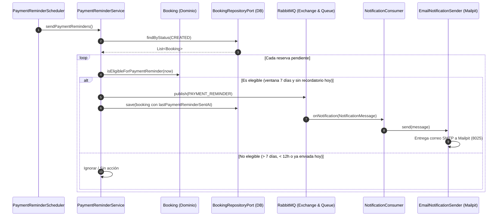

# Notificaciones de Recordatorio de Pago (RabbitMQ & Mailpit)

Documento breve y operativo sobre el flujo de mensajería asíncrona para los **recordatorios diarios de pago** de mentorías en SkillBridge AI.

---

## 1. Reglas de Negocio y Tiempos Límites

1. **Vencimiento de pago:** El pago de una reserva en estado `CREATED` vence exactamente **12 horas antes** del inicio de la sesión (`scheduledAt - 12h`). A menos de 12 horas, la reserva no puede pagarse y se cancela.
2. **Ventana de recordatorios (Día 7):** El primer recordatorio se activa cuando faltan **7 días para el vencimiento del pago** (es decir, **7 días y 12 horas** antes del inicio de la sesión).
3. **Frecuencia y control anti-spam:** Se envía **1 recordatorio por día** hasta llegar al límite de pago (validando que hayan transcurrido al menos 24 horas desde la última notificación enviada).
4. **Hora de entrega al usuario:** El proceso cron se ejecuta automáticamente todas las mañanas a las **08:00 AM UTC**.

> [!NOTE]
> **Sobre la hora de entrega y zona horaria:**
> * **En producción:** El servidor corre de forma continua en **UTC**. Por lo tanto, las **08:00 AM UTC** equivalen a las **03:00 AM hora de Colombia/Perú (UTC-5)** o **05:00 AM de Argentina/Chile (UTC-3)**. Si el equipo desea que el correo llegue a las 08:00 AM hora de Colombia (UTC-5), basta con ajustar la variable `notifications.payment-reminder.cron: 0 0 13 * * *` (13:00 UTC) en el entorno sin tocar código.
> * **En pruebas locales:** Te llega de inmediato al reiniciar el contenedor gracias al listener `onStartup` (`ApplicationReadyEvent`), diseñado precisamente para no tener que esperar hasta las 08:00 AM para verificar en Mailpit.

---

## 2. Ejemplo Práctico de Fechas

> **Escenario:** Hoy es **Miércoles 11 de Noviembre a las 12:00 PM** y deseas crear una reserva para probar el recordatorio del **Día 7**.

| Hito | Fecha y Hora | Explicación |
|---|---|---|
| **1. Creación de la reserva** | **11 Noviembre, 12:00 PM** (HOY) | Momento en que estás frente a la web creando la reserva |
| **2. Fecha elegida para la sesión** | **19 Noviembre, 12:00 AM** (Medianoche) | Fecha que seleccionas en el calendario de la mentoría |
| **3. Límite de vencimiento de pago** | **18 Noviembre, 12:00 PM** (Mediodía) | Exactamente 12 horas antes del inicio de la sesión |
| **4. ¿Cuándo se activa el Recordatorio Día 7?** | **11 Noviembre** (¡HOY MISMO!) | Porque desde hoy (11 Nov) hasta el límite de pago (18 Nov) faltan **7 días exactos** |

* **Resultado:** Al agendar la sesión para el 19 de Noviembre a las 12:00 AM (o entre 12:00 AM y 12:00 PM), hoy mismo te llegará el primer correo diciendo que tu límite de pago es hasta el 18 de Noviembre a las 12:00 PM.
* Mañana (12 de Noviembre) te llegará el del Día 6, el 13 de Noviembre el del Día 5, y así sucesivamente.
* Si programas la sesión con menos tiempo (ej. para dentro de 3 días), también entrará de inmediato en la ventana activa de recordatorios.

---

## 3. Topología de Mensajería

```text
PaymentReminderScheduler (08:00 AM UTC o al iniciar)
        ↓
PaymentReminderService (filtra reservas elegibles CREATED)
        ↓
NotificationPublisherPort (RabbitNotificationPublisher)
        ↓
notification.exchange (Topic Exchange)
        ↓ routingKey: notification.payment.reminder
notification.queue (Durable)
        ↓
NotificationConsumer (@RabbitListener)
        ↓
EmailNotificationSender (JavaMailSender hacia Mailpit)
```

---

## 4. Secuencia y Responsabilidades a Nivel de Código

### A. Componentes por capa hexagonal
1. **`PaymentReminderScheduler` (Infraestructura / Inbound Adapter):**
   * Anotado con `@Scheduled(cron = "...")` y `@EventListener(ApplicationReadyEvent.class)`.
   * Dispara el caso de uso `SendPaymentRemindersUseCase` al iniciar y a las 08:00 AM.
2. **`PaymentReminderService` (Aplicación / Caso de uso):**
   * Consulta las reservas con estado `CREATED` mediante `BookingRepositoryPort.findByStatus(...)`.
   * Para cada reserva, consulta la regla de negocio pura en `booking.isEligibleForPaymentReminder(now)`.
   * Si es elegible: publica el mensaje en RabbitMQ y persiste `lastPaymentReminderSentAt = now` en la base de datos (PostgreSQL vía `V13`).
3. **`Booking` (Dominio puro):**
   * Calcula `paymentDeadline()` (`scheduledAt - 12h`).
   * Valida: `status == CREATED`, `now < deadline`, `now >= deadline - 7 días`, y transcurso $\ge$ 24 horas desde el último recordatorio enviado.
4. **`RabbitNotificationPublisher` (Infraestructura / Outbound Messaging):**
   * Envía el recordatorio al exchange `notification.exchange` con routing key `notification.payment.reminder`.
5. **`NotificationConsumer` (Infraestructura / Inbound Messaging):**
   * Consume de `notification.queue` y delega en `ProcessNotificationUseCase`.
6. **`EmailNotificationSender` (Infraestructura / Outbound Notification):**
   * Resuelve el correo del usuario vía `UserRepositoryPort`.
   * Redacta asunto y cuerpo, enviándolo por SMTP (`JavaMailSender`) hacia Mailpit.

### B. Diagrama de Secuencia



---

## 5. Guía Rápida para Probar en Mailpit (Puerto 8025)

### Paso 1: Configurar variable en `.env`
En la raíz del proyecto, en tu archivo `.env`:
```env
NOTIFICATIONS_SENDER=email
```

### Paso 2: Crear la reserva en la web
1. Entra a `http://localhost:8088`.
2. Agenda una sesión seleccionando una fecha que esté dentro de la ventana (siguiendo el ejemplo anterior, entre 3 y 7 días a futuro).
3. La reserva quedará guardada en estado `CREATED` (*Pendiente de pago*).

### Paso 3: Reiniciar el backend para ejecutar la tarea de inicio
Ejecuta en tu terminal:
```bash
docker compose down
docker compose up -d --build backend
```
*(Al arrancar, el `PaymentReminderScheduler` ejecuta el listener `@EventListener(ApplicationReadyEvent.class)`, detecta la reserva y publica el mensaje a RabbitMQ).*

### Paso 4: Visualizar el correo en Mailpit
1. Abre en tu navegador: **`http://localhost:8025`**
2. Verás en la bandeja de entrada:
   * **De:** `no-reply@skillbridge.local`
   * **Asunto:** `Recordatorio: Pago pendiente de tu mentoría`
   * **Cuerpo:** `Hola [Usuario], tu reserva [ID] está pendiente de pago. Recuerda que su límite de pago es hasta el [Fecha límite, ej: 18 de noviembre a las 12:00 PM UTC].`

